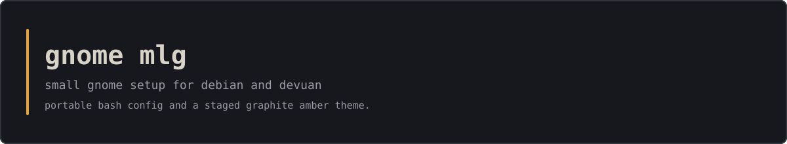

# GNOME MLG

deploys a portable bash config and stages a graphite amber theme archive for a small gnome desktop on debian or devuan.

[read the quick start](#quick-start)

| | |
| --- | --- |
| **bash** | copies `configs/bash/.bashrc` to `~/.bashrc` and keeps a timestamped backup. |
| **apps** | enables i386, installs git and wget when missing, and installs oh-my-bash when absent. |
| **theme** | stages `graphite-amber-theme.7z`, extracts the real Graphite Amber GTK/Shell/Metacity theme, and applies it with `gsettings` when available. |
| **verify** | `./install.sh --verify` reads current state only. |

## Quick start

```bash
git clone https://github.com/SOSMLG/GnomeMLG.git
cd GnomeMLG
./install.sh
```

`install.sh` runs every step with prompts answered yes, then runs the
verifier. Reboot or log out and back in after the bash config is deployed.

For a step-by-step run:

```bash
./install.sh              # prompts before each step
./install.sh --list       # show step names
./install.sh --verify     # audit the current state only
```

## What it does

| Step | Effect |
|---|---|
| `bash` | Copies `configs/bash/.bashrc` to `~/.bashrc`, keeping a timestamped backup. The config uses `$HOME` instead of a fixed username. |
| `apps` | Enables the `i386` architecture, installs `git` and `wget` when missing, and installs oh-my-bash from its upstream installer when `~/.oh-my-bash` is absent. |
| `theme` | Copies `graphite-amber-theme.7z` into `$XDG_DATA_HOME/gnome-mlg` (default `~/.local/share/gnome-mlg`). If 7z is installed, it backs up `~/.themes`, extracts the bundled Graphite Amber GTK3/GTK4/Shell/Metacity theme and flat wallpaper there, and sets the GNOME theme keys with `gsettings`. Otherwise it tells you where to extract it manually. |

The app step never upgrades the whole system and never runs as root. Package
names are checked before install, so steps are safe to re-run.

## Options

| Option | Meaning |
|---|---|
| `--list` | Print step names and exit. |
| `--yes`, `-y` | Accept defaults without prompting. |
| `--full` | Run all steps and then verify. Used by `install.sh`. |
| `--only bash,apps` | Run selected steps. |
| `--no-update` | Skip `apt-get update` in the apps step. |
| `--verify` | Run only the end-state verifier. |
| `-h`, `--help` | Show help. |

Environment overrides:

| Variable | Meaning |
|---|---|
| `GNOMEMLG_PRIV` | Force `sudo` or `doas` as the escalation helper. |
| `GNOMEMLG_SKIP_APT_UPDATE=1` | Skip the apt lists refresh. |
| `GNOMEMLG_OMB_INSTALL=0` | Do not run the oh-my-bash installer. |

## Verification

```bash
./verify.sh
./verify.sh --json
```

The verifier is read-only. It checks the repo payload, the portable bashrc
path, the deployed bashrc, oh-my-bash, the staged theme archive, the extracted
Graphite Amber theme and the i386 architecture. It prints `PASS`, `WARN` or
`FAIL` and exits nonzero only on `FAIL`.

## Layout

```
install.sh                 unattended wrapper
install.sh                     ordered step runner
verify.sh                  read-only end-state verifier
scripts/lib/common.sh      shared helpers (priv, logging, backups)
configs/bash/.bashrc       portable bash config
configs/gnome/GnomeApps.sh app prerequisite step
graphite-amber-theme.7z    bundled Graphite Amber theme archive
AGENTS.md                  project conventions
```

## License

MIT. See [LICENSE](LICENSE).

## Related repos

- [DebianSway](https://github.com/SOSMLG/DebianSway): Sway on Debian/Devuan.
- [DevuanSway](https://github.com/SOSMLG/DevuanSway): Sway on Devuan with OpenRC.
- [Devuan-Kde](https://github.com/SOSMLG/Devuan-Kde): KDE Plasma on Devuan.
- [XfceMlg](https://github.com/SOSMLG/XfceMlg): XFCE desktop toolkit.

## Repository standard

This repo follows the SOSMLG standard: [contributing](CONTRIBUTING.md), [security](SECURITY.md), [changelog](CHANGELOG.md). Local workflow: [English guide](https://github.com/SOSMLG/.github/blob/main/docs/GIT_GUIDE.md) / [Arabic guide](https://github.com/SOSMLG/.github/blob/main/docs/GIT_GUIDE.ar.md). Visual standard: [theme](https://github.com/SOSMLG/.github/blob/main/docs/THEME.md) / [الطابع البصري](https://github.com/SOSMLG/.github/blob/main/docs/THEME.ar.md).
